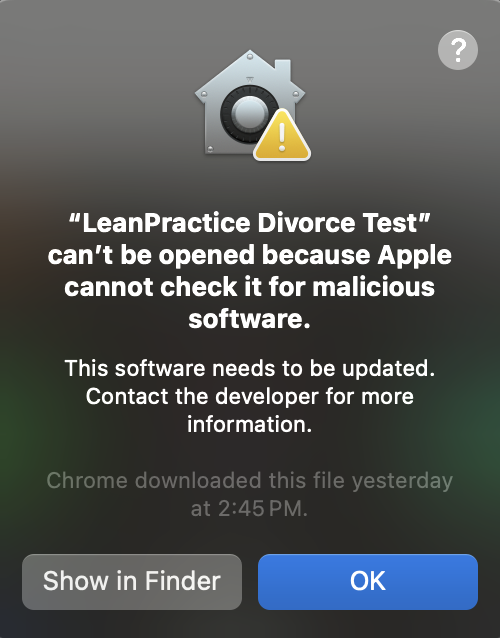
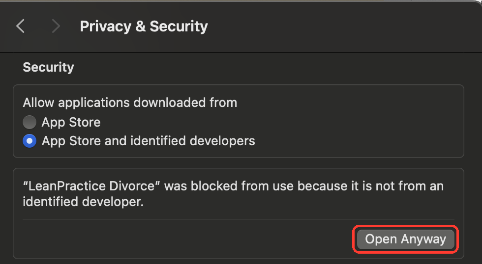
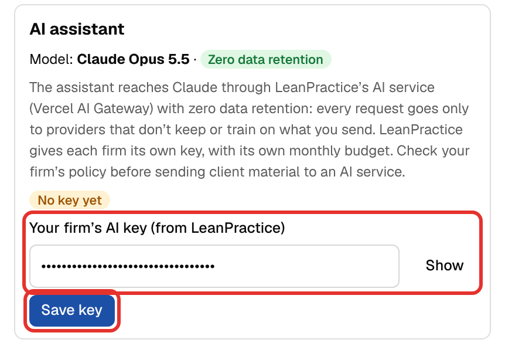
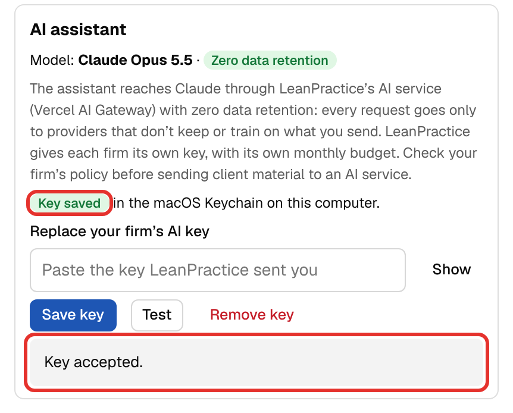

# Installing LeanPractice Divorce

How to download and install the LeanPractice Divorce desktop app on a **Mac** or a **Windows PC**, set it up
the first time, and keep it up to date. It takes about five minutes. No administrator rights are needed on
either system.

- [Before you start](#before-you-start)
- [Download](#1-download)
- [Install on a Mac](#2a-install-on-a-mac)
- [Install on Windows](#2b-install-on-windows)
- [First launch: set up the app](#3-first-launch-set-up-the-app)
- [Updates](#updates)
- [Moving to a new computer](#moving-to-a-new-computer)
- [Uninstalling](#uninstalling)
- [Troubleshooting](#troubleshooting)

## Before you start

| | Mac | Windows |
| --- | --- | --- |
| System | macOS 12 Monterey or later | Windows 10 or 11 (64-bit) |
| Processor | Apple Silicon (M1 or later) or Intel; there is a download for each | Any 64-bit PC |
| Rights | Your normal user account | Your normal user account (no admin prompt) |
| Internet | Needed to download, for updates and for the AI assistant | Same; the installer may also download Microsoft WebView2 if the PC doesn't have it |

You will also want **your firm's AI key**, which LeanPractice sends to each firm separately. The app works
without it; only the AI assistant needs it, and you can add it later (see [Your AI key](#your-ai-key)).

### Which Mac do I have?

Open the **Apple menu  › About This Mac**.

- If it shows **Chip: Apple M1** (or M2, M3, M4…), you have an **Apple Silicon** Mac.
- If it shows **Processor: … Intel …**, you have an **Intel** Mac.

## 1. Download

Go to the downloads page:

**<https://github.com/Q4Justice/leanpractice-divorce-desktop-releases>**

It always lists the newest version. Under **Download version …**, choose the file for your computer:

| Computer | File name ends in |
| --- | --- |
| Mac with Apple Silicon (M1 or later) | `_aarch64.dmg` |
| Mac with Intel | `_x64.dmg` |
| Windows 10 or 11 | `_x64-setup.exe` |

The file goes to your **Downloads** folder. You don't need a GitHub account to download it.

> Ignore the files ending in `.sig`, `.tar.gz` and `latest.json` on the release page. Those are for the
> app's automatic updates.

## 2a. Install on a Mac

1. Open **Downloads** and double-click the `.dmg` file, for example
   `LeanPractice.Divorce_1.1.0_aarch64.dmg`. A window opens with the app and an **Applications** folder.
2. **Drag LeanPractice Divorce onto the Applications folder.**
3. Close the window, then eject the disk image: in Finder's sidebar, click the ⏏ next to
   **LeanPractice Divorce**. You can delete the `.dmg` from Downloads.
4. Open **Applications** and double-click **LeanPractice Divorce**.

Open the app from **Applications**, not from the disk image window. A copy opened from the disk image can't
install updates.

### The first time you open it: "Open Anyway"

The app isn't yet registered with Apple, so the first time you open it macOS says it **can't be opened
because Apple cannot check it for malicious software**. This is expected, and you only allow it once.

1. Click **OK** on the message. (On newer macOS versions the buttons are **Done** and **Move to Trash**;
   click **Done**, never **Move to Trash**.)

   

2. Open the **Apple menu  › System Settings › Privacy & Security**. (Or type **Gatekeeper** in the
   System Settings search box.)
3. Scroll down to **Security**. Under *"LeanPractice Divorce" was blocked from use because it is not from an
   identified developer*, click **Open Anyway**.

   

4. Enter your Mac password (or use Touch ID), then click **Open** (or **Open Anyway**) when macOS asks once
   more.

The app opens. From now on it opens normally from Applications, Launchpad or Spotlight. To keep it in the
Dock, right-click its Dock icon while it is open and choose **Options › Keep in Dock**.

> **macOS 12–14:** the **Open Anyway** button is in **System Preferences › Security & Privacy › General**
> (macOS 12) or **System Settings › Privacy & Security** (macOS 13 and 14). It appears there for about an
> hour after the blocked attempt; if you don't see it, open the app again and go straight back.

## 2b. Install on Windows

1. Open **Downloads** and double-click the setup file, for example
   `LeanPractice.Divorce_1.1.0_x64-setup.exe`.
2. If Windows shows **"Windows protected your PC"**, click **More info**, then **Run anyway**. The app isn't
   yet signed with a Windows certificate, so SmartScreen doesn't recognise it. This is expected.
3. Follow the installer: click **Next**, then **Install**, then **Finish**. You won't be asked for an
   administrator password; the app installs for your Windows user only.
4. If the PC doesn't have Microsoft WebView2 (most Windows 10 and 11 PCs already do), the installer downloads
   and installs it. This needs an internet connection and takes a minute.

Open the app from the **Start menu** or the **LeanPractice Divorce** shortcut on the desktop. To pin it,
right-click the Start menu entry and choose **Pin to taskbar**.

> If your firm's IT blocks unsigned programs, send them this page. The app installs per user under
> `%LOCALAPPDATA%\LeanPractice Divorce` and needs outbound HTTPS to `github.com` and GitHub's download
> servers (`*.githubusercontent.com`) for updates, and to `ai-gateway.vercel.sh` for the AI assistant.

## 3. First launch: set up the app

### Your cases folder

The first time it opens, the app creates a folder for your cases:

- Mac: **Documents › LeanPractice Cases**
- Windows: **Documents\LeanPractice Cases**

A blue banner shows where it is. Click **OK**. Every case is saved as a file in that folder, on your computer;
nothing is stored on a LeanPractice server.

To keep the cases somewhere else (for example in **iCloud Drive**, **OneDrive** or **Dropbox**, for off-site
backup), click **Settings** (top right) › **Where cases are saved** › **Change folder…**. Existing cases are
copied into the new folder; the old folder is left as it was.

### Your AI key

The AI assistant needs the key LeanPractice sent your firm (by email or another secure channel). The rest of
the app works without it. Have that message open, then:

1. Click **Settings** at the top right of the window. The Settings panel opens on the right.

   

2. Scroll down the panel to the **AI assistant** section. Until a key is added it shows **No key yet**.
3. Copy the whole key from LeanPractice's message and paste it into **Your firm's AI key (from LeanPractice)**
   (**⌘ Cmd + V** on a Mac, **Ctrl + V** on Windows). The key appears as dots; click **Show** to check that
   all of it was pasted, with no spaces before or after.
4. Click **Save key** (or press **Enter**).

   

5. The app checks the key with LeanPractice's AI service. When it is good, the section shows **Key saved** and
   **Key accepted**.

   

Close Settings with the **×** at its top right. To use the assistant, open a case and click **AI assistant**
at the top of the window.

The key is kept in the **macOS Keychain** or **Windows Credential Manager** on this computer, not in a file.
Each person enters it once per computer. To check it later, open **Settings › AI assistant** and click
**Test**; to replace it, paste the new key and click **Save key**. If the key isn't accepted, see
[Troubleshooting](#troubleshooting).

### Your name

In **Settings › You**, type your name. It is shown in each case's version history, so colleagues sharing a
cases folder can see who changed what.

### Try it

On the **Cases** screen, click **Open the sample case** to explore the worksheet with a fictitious case, or
**New case** to start your own.

## Updates

You only install the app once. After that it checks for a new version when it opens and every 6 hours. When
one is available, a banner says **Version … is available**, with a **What's new** list:

- Click **Install and restart**. The app saves the open case, backs up all your cases, downloads the update,
  checks its LeanPractice signature, installs it and reopens. Your cases, settings and AI key stay as they are.
- Or click **Later**; the banner comes back the next time the app opens.

To check yourself, open **Settings › Updates › Check for updates**. The same section shows which version you
have.

> **Mac:** after an update, macOS may ask for your Mac password so the app can read its saved AI key. Enter it
> and click **Always Allow**.

## Moving to a new computer

1. Install the app on the new computer (steps above) and enter your AI key.
2. Bring your cases across, either:
   - **The whole folder:** copy your **LeanPractice Cases** folder to the new computer, then in the app choose
     **Settings › Where cases are saved › Change folder…** and pick it. If the folder is already in iCloud
     Drive, OneDrive or Dropbox, just pick it there.
   - **One case at a time:** on the old computer, open the case and choose **Settings › Case files › Export
     this case…**; on the new one, **Import case file…** on the Cases screen.

## Uninstalling

Uninstalling removes the app only. **Your cases folder is never deleted**; remove it yourself if you want to.

- **Mac:** quit the app, then drag **LeanPractice Divorce** from **Applications** to the Trash. To also
  remove its settings, delete `~/Library/Application Support/com.q4justice.leanpractice.divorce`. The AI key
  is in **Keychain Access** under `com.q4justice.leanpractice.divorce`.
- **Windows:** **Settings › Apps › Installed apps** (Windows 11) or **Apps & features** (Windows 10) ›
  **LeanPractice Divorce** › **Uninstall**. Tick **Delete the application data** to also remove its settings.
  The AI key is in **Credential Manager › Windows Credentials**.

## Troubleshooting

| What you see | What to do |
| --- | --- |
| Mac: *"LeanPractice Divorce" is damaged and can't be opened* | You have version 1.0.2 or older. Delete it and download the current version from the downloads page. |
| Mac: the message says *This item is on the disk image "LeanPractice.Divorce_…dmg"* | You opened the app from the disk image window. Allow it as above if you like, but then drag it into **Applications** and open it from there, or it can't update itself. |
| Mac: no **Open Anyway** button in Privacy & Security | Open the app once more from Applications, then go straight back to **Privacy & Security**; the button appears only for a while after a blocked attempt. |
| Mac: the app in Applications is called **LeanPractice MSA Worksheet** | That's the app's old name, kept by updates. It is the same app; you can rename it or leave it. |
| Windows: **Windows protected your PC** | Click **More info › Run anyway**. |
| Windows: the installer stops while "downloading WebView2" | Connect to the internet and run the setup file again, or ask IT to install Microsoft Edge WebView2 Runtime. |
| **The cases folder can't be found** | The folder is on a drive, network share or cloud folder that isn't available. Connect it and click **Try again**, or **Choose a folder…**. |
| The assistant says **Add the AI key…** or that the key wasn't accepted | Enter or re-enter the key in **Settings › AI assistant**, then click **Test**. If it still fails, ask LeanPractice for a new key. |
| The assistant says your firm's AI budget for this month is used up | Ask LeanPractice to raise it. |
| **Couldn't check for updates** in Settings | Check the internet connection. Your firm's network must allow `github.com`. |
| A case opens **Read-only** | It was saved by a newer version of the app on another computer. Update this copy (**Settings › Updates**). |

Still stuck? Contact LeanPractice with a screenshot of the message and the version shown in
**Settings › About this copy**.
